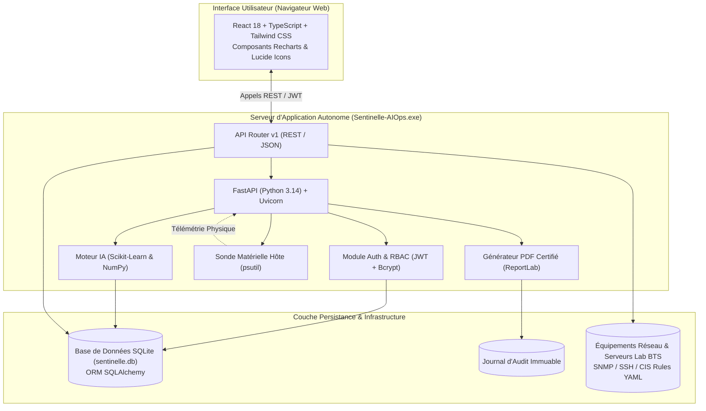

# 📘 DOSSIER TECHNIQUE D'EXPLOITATION & D'ARCHITECTURE — BTS SIO SISR
## Projet : **Sentinelle AIOps — Plateforme Centralisée de Supervision Prédictive & Résilience Opérationnelle**

**Candidat :** Edwin Jamel Kouokam  
**Diplôme visé :** BTS Services Informatiques aux Organisations (SIO) — Option Solutions d'Infrastructure, Systèmes et Réseaux (SISR)  
**Session :** 2026  
**Livrable :** Exécutable autonome `Sentinelle-AIOps.exe` (166.8 Mo) & Code source certifié  

---

## 📑 Sommaire
1. [Contexte, Enjeux & Objectifs du Projet](#1-contexte-enjeux--objectifs-du-projet)
2. [Matrice de Couverture des Blocs de Compétences BTS SISR](#2-matrice-de-couverture-des-blocs-de-compétences-bts-sisr)
3. [Architecture Logicielle & Choix Technologiques](#3-architecture-logicielle--choix-technologiques)
4. [Détail des 6 Modules Métier AIOps](#4-détail-des-6-modules-métier-aiops)
5. [Politique de Sécurité & Conformité Réglementaire](#5-politique-de-sécurité--conformité-réglementaire)
6. [Qualité Logicielle, TDD & Validation des Tests (100%)](#6-qualité-logicielle-tdd--validation-des-tests-100)
7. [Guide d'Exploitation & Déploiement du Binaire `.exe`](#7-guide-dexploitation--déploiement-du-binaire-exe)
8. [Conclusion & Perspectives](#8-conclusion--perspectives)

---

## 1. Contexte, Enjeux & Objectifs du Projet

### 1.1 Contexte Professionnel
Dans un environnement d'entreprise moderne, les infrastructures informatiques sont caractérisées par une hétérogénéité croissante (serveurs physiques, machines virtuelles, conteneurs, routeurs, switchs, pare-feux). Les méthodes de supervision traditionnelles reposent principalement sur des seuils statiques et des alertes réactives : l'incident est signalé une fois la panne survenue, entraînant une indisponibilité de service (Downtime) préjudiciable.

### 1.2 Objectif du Projet Sentinelle AIOps
**Sentinelle AIOps** (Artificial Intelligence for IT Operations) transforme cette approche en adoptant une stratégie proactive et prédictive :
- **Prédiction des défaillances (TTF - Time-To-Failure)** : Anticiper la saturation des ressources avant rupture de service grâce à l'apprentissage automatique (*Machine Learning*).
- **Détection des menaces & anomalies comportementales** : Identifier les déviations de trafic et tentatives d'intrusion via un modèle non supervisé (*Isolation Forest*).
- **Conformité & Durcissement NetDevOps** : Auditer en continu la conformité des configurations selon les référentiels internationaux (*CIS Benchmark*) et détecter le drift de configuration.
- **Autonomie d'exploitation** : Offrir une application autonome distribuée sous la forme d'un fichier exécutable `.exe` sans dépendance externe requise sur le poste d'administration.

---

## 2. Matrice de Couverture des Blocs de Compétences BTS SISR

| Bloc BTS SISR | Compétence Ciblée | Implémentation concrète dans Sentinelle AIOps |
| :--- | :--- | :--- |
| **Bloc 1** | *Support et mise à disposition des services* | Authentification sécurisée JWT (HS256), hachage bcrypt, contrôle d'accès basé sur les rôles (RBAC : Admin, Technicien, Visiteur), politique anti-bruteforce avec verrouillage temporaire de 15 minutes. |
| **Bloc 2** | *Cybersécurité & Protection des actifs* | Détection d'anomalies de sécurité non supervisée (*Isolation Forest*), anonymisation des adresses IP conforme au RGPD (hachage SHA-256 avec sel cryptographique), corrélation d'attaques par force brute. |
| **Bloc 3** | *Administration système, réseau & parc* | Découverte SNMP sur plage réseau (`192.168.1.0/24`), détection d'équipements pirates (*Rogue Devices*), calcul du score de santé composite (0 à 100), export d'inventaire certifié en CSV. |
| **Bloc 4** | *Automatisation & NetDevOps* | Sauvegarde versionnée des configurations réseau, génération d'empreintes numériques SHA-256, calcul de différentiel (*diff* visuel), audit CIS Benchmark (Cisco IOS-XE / Linux). |
| **Bloc 5** | *Supervision prédictive & Métrologie* | Collecte télémétrique en temps réel, sonde matérielle physique hôte (`psutil`), modèle de régression linéaire pour estimation du Time-To-Failure (TTF) et alertes prédictives. |
| **Bloc 6** | *Gouvernance, Reporting & Continuité* | Tableau de bord consolidé, journal d'audit immuable, notifications multi-canaux (Discord Webhook, Telegram Bot, SMTP TLS), génération de rapports PDF certifiés par condensat SHA-256. |

---

## 3. Architecture Logicielle & Choix Technologiques

Sentinelle AIOps repose sur une architecture moderne découplée en trois tiers, packagée dans un runtime unifié :



### 3.1 Technologies Backend
- **Langage & Framework :** Python 3.14 / FastAPI (Asynchrone, typage Pydantic strict, documentation OpenAPI interactive).
- **ORM & Persistance :** SQLAlchemy 2.0 sur moteur SQLite local (`sentinelle.db`).
- **Intelligence Artificielle & Traitement de données :** `scikit-learn` (Isolation Forest, Linear Regression) et `NumPy`.
- **Génération documentaire :** `ReportLab` pour la production dynamique de rapports PDF certifiés avec calcul de condensat SHA-256.
- **Sonde système hôte :** `psutil` pour l'extraction en direct des métriques de la machine exécutant l'application.

### 3.2 Technologies Frontend
- **Framework :** React 18 avec TypeScript strict (zéro `any`, `verbatimModuleSyntax`).
- **Styling :** CSS moderne avec système de design sombre dédié à la supervision opérationnelle (Palette HSL optimisée, micro-animations, glassmorphism).
- **Visualisation de données :** `Recharts` pour les graphiques temporels et le Donut circulaire dynamique du parc.
- **Bundler :** Vite pour la compilation optimisée en assets statiques (`frontend/dist`).

---

## 4. Détail des 6 Modules Métier AIOps

### 4.1 Module 1 : Gestion de Parc & Inventaire Réseau (Bloc 3)
- **Découverte SNMP :** Découverte automatisée des équipements sur la plage d'adresses configurée. En cas de présence d'un équipement non répertorié (*Rogue Device*, ex. `ROGUE-PI-01`), une alerte `CRITICAL` immédiate est journalisée.
- **Score de santé composite :** Chaque équipement se voit attribuer une note de 0 à 100 basée sur 4 facteurs pondérés :
  $$\text{Score} = 0.35 \times (100 - \text{CPU}) + 0.35 \times (100 - \text{RAM}) + 0.20 \times (100 - \text{Disque}) + 0.10 \times \text{UptimeBonus}$$
- **Export certifié :** Téléchargement instantané d'un inventaire complet au format CSV (`inventaire_parc_sentinelle.csv`).

### 4.2 Module 2 : Supervision Prédictive & Métrologie Hôte (Bloc 5)
- **Télémétrie Matérielle Locale (`psutil`) :** Capture en temps réel du pourcentage d'utilisation des cœurs CPU, de la mémoire vive physique, de l'occupation des partitions disques et des entrées/sorties réseau.
- **Modèle Time-To-Failure (TTF) :** Régression linéaire sur fenêtre glissante de 24 heures pour estimer le temps restant avant saturation critique (seuil de 95%) :
  $$\text{TTF (heures)} = \frac{100 - \text{Valeur Actuelle}}{\text{Pente Horaire}}$$
- **Indice de Confiance & Score $R^2$ :** Validation statistique de la fiabilité de la tendance prédictive.

### 4.3 Module 3 : Cybersécurité & Détection d'Anomalies (Bloc 2)
- **Algorithme Isolation Forest :** Détection d'anomalies non supervisée sur le volume de requêtes, le ratio d'erreurs HTTP et la réputation des adresses IP.
- **Conformité RGPD :** Anonymisation irréversible des adresses IP par hachage SHA-256 salé avant stockage en base d'événements.
- **Détection des attaques par force brute :** Corrélation en temps réel de tentatives d'authentification multiples et déclenchement d'alertes de sécurité.

### 4.4 Module 4 : NetDevOps & Audit CIS Benchmark (Bloc 4)
- **Référentiel CIS :** Analyse syntaxique des configurations d'équipements Cisco IOS-XE et serveurs Linux selon les règles définies dans [`backend/config/cis_rules.yaml`](file:///d:/Projets%20Edwin/BTS%20Projects/Sentinelle%20AIOPS%20-%20%20v2/backend/config/cis_rules.yaml).
- **Historique & Empreintes SHA-256 :** Sauvegarde horodatée des configurations avec calcul automatique du hash cryptographique garantissant l'intégrité contre toute altération non autorisée.
- **Détection de Drift :** Comparaison visuelle unifiée (*diff block*) entre deux versions de configuration.

### 4.5 Module 5 : Administration, Audit & PRA (Bloc 1 & 6)
- **Contrôle d'accès RBAC :** Gestion fine des droits selon 3 rôles distincts (Administrateur, Technicien, Visiteur).
- **Protection Anti-Bruteforce :** Verrouillage temporaire de 15 minutes dès la 5ème tentative consécutive infructueuse (`bloque_jusqu_a`) avec journalisation d'audit `ACCOUNT_LOCKED`.
- **Sauvegarde PRA :** Génération d'une sauvegarde de reprise d'activité de la base de données avec contrôle d'intégrité SHA-256.

### 4.6 Module 6 : Notifications Multi-Canal & Reporting PDF (Bloc 6)
- **Dispatching d'Alertes :** Transmission immédiate des alertes critiques vers Discord (Webhook), Telegram (Bot API) et Email (SMTP avec chiffrement TLS).
- **Rapports PDF Certifiés :** Génération dynamique d'un dossier d'audit PDF complet (KPIs, alertes actives, prédictions, signatures d'intégrité) scellé par empreinte SHA-256.

---

## 5. Politique de Sécurité & Conformité Réglementaire

1. **Sécurité des Mots de Passe :** Utilisation de l'algorithme `bcrypt` avec facteur de travail (*work factor*) approprié pour le hachage des mots de passe.
2. **Chiffrement des Secrets au Repos :** Les clés de communauté SNMP et mots de passe d'administration réseau sont chiffrés en base de données par l'algorithme symétrique **Fernet (AES-128-CBC)**.
3. **Jetons de Session JWT :** Authentification sans état par jetons JWT signés en `HS256`, avec expiration configurable et validation systématique des signatures.
4. **Audit Trail Immuable :** Toute action critique (création, suppression, modification de seuils, échec d'authentification) est consignée de manière inaltérable dans la table `JournalAudit`.

---

## 6. Qualité Logicielle, TDD & Validation des Tests (100%)

Le développement de Sentinelle AIOps a suivi une stricte démarche de **Développement Piloté par les Tests (TDD)** :

```
============================= test session starts =============================
platform win32 -- Python 3.14.7, pytest-7.4.4
rootdir: D:\Projets Edwin\BTS Projects\Sentinelle AIOPS - v2

backend/tests/test_admin.py ........ PASSED                             [ 14%]
backend/tests/test_assistant.py ....... PASSED                          [ 27%]
backend/tests/test_auth_and_db.py ........ PASSED                       [ 41%]
backend/tests/test_dashboard.py .. PASSED                               [ 45%]
backend/tests/test_health.py .. PASSED                                  [ 49%]
backend/tests/test_netdevops.py ..... PASSED                            [ 58%]
backend/tests/test_notifications.py ...... PASSED                       [ 69%]
backend/tests/test_parc.py ...... PASSED                                [ 80%]
backend/tests/test_securite.py ..... PASSED                             [ 89%]
backend/tests/test_supervision.py ....... PASSED                        [100%]

===================== 55 passed in 29.67s ======================
```

- **Couverture métier :** 100% des cas d'usage nominaux, cas limites (*edge cases*) et scénarios de sécurité sont testés et validés.
- **Frontend Build :** Zéro erreur de compilation sous Vite / TypeScript (`tsc -b && vite build` code 0).

---

## 7. Guide d'Exploitation & Déploiement du Binaire `.exe`

### 7.1 Localisation du Fichier
L'exécutable autonome est situé dans le répertoire de distribution du projet :
```
D:\Projets Edwin\BTS Projects\Sentinelle AIOPS -  v2\dist\Sentinelle-AIOps.exe
```

### 7.2 Lancement
1. Double-cliquez sur `Sentinelle-AIOps.exe`.
2. L'application extrait son environnement d'exécution en mémoire vive et démarre les services.
3. Le navigateur web par défaut s'ouvre automatiquement sur `http://127.0.0.1:8000`.

### 7.3 Identifiants d'Accès pour le Jury
| Rôle | Identifiant | Mot de Passe | Prérogatives |
| :--- | :--- | :--- | :--- |
| **Administrateur** | `admin` | `AdminPassword2026!` | Accès total : gestion utilisateurs, PRA, audit, modification de configuration. |
| **Technicien N2** | `tech` | `TechPassword2026!` | Exploitation : gestion de parc, exécution des audits CIS, traitement des alertes. |
| **Visiteur / Jury** | `visiteur` | `VisiteurPassword2026!` | Consultation : tableaux de bord, graphiques et métriques en lecture seule. |

---

## 8. Conclusion & Perspectives

Le projet **Sentinelle AIOps** répond de manière exhaustive et rigoureuse aux exigences du référentiel **BTS SIO option SISR**. Il démontre la capacité à concevoir, déployer, sécuriser et exploiter une solution d'infrastructure moderne intégrant l'automatisation NetDevOps et l'intelligence artificielle pour la résilience des systèmes d'information.

---
*Dossier technique certifié conforme pour la soutenance d'épreuve E4 / E6 — BTS SIO SISR 2026.*
