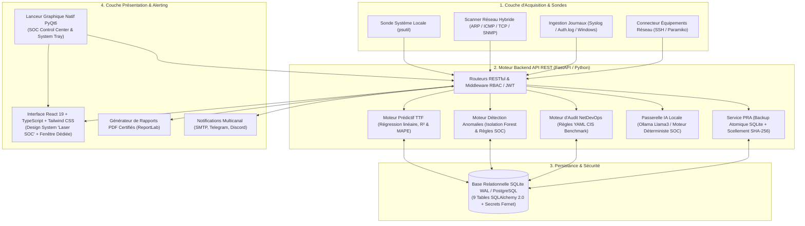

<div align="center">


# Sentinelle AIOps v2.0

**Plateforme Centralisée d'Administration Système & Réseau, Supervision Prédictive, Cybersécurité et NetDevOps**

[](backend/)
[](backend/app/main.py)
[](frontend/)
[](backend/app/modules/)
[](launcher.py)
[](.github/workflows/ci.yml)

*« La plateforme Sentinelle AIOps transforme l'administration système et réseau d'une gestion réactive, cloisonnée et manuelle vers un pilotage unifié, prédictif, sécurisé et partiellement automatisé. »*

[Cahier des Charges PDF](Documentation/Cahier_des_Charges_Sentinelle_AIOps_v2.pdf) • [Dossier technique](Documentation/DOSSIER_TECHNIQUE.md) • [Historique (feuille de route)](Documentation/Fonctionnalité_v2.md) • [Validation sur réseau réel](Documentation/VALIDATION_TERRAIN.md)

</div>

---

## Sommaire

1. [Contexte & Problématique](#1-contexte--problématique)
2. [Proposition de Valeur & Comparatif](#2-proposition-de-valeur--comparatif)
3. [Principes de fonctionnement](#3-principes-de-fonctionnement)
4. [Architecture Technique & Structure du Projet](#4-architecture-technique--structure-du-projet)
5. [Spécifications des 6 Modules Métier](#5-spécifications-des-6-modules-métier)
6. [Modèle de Données (Base Relationnelle)](#6-modèle-de-données-base-relationnelle)
7. [Sécurité Applicative, RBAC & PRA](#7-sécurité-applicative-rbac--pra)
8. [Design System « Laser SOC » & Expérience Desktop](#8-design-system--laser-soc---expérience-desktop)
9. [Installation, Exécution & Compilation](#9-installation-exécution--compilation)
10. [Première mise en service et comptes](#10-première-mise-en-service-et-comptes)
11. [Tests & Validation Qualité](#11-tests--validation-qualité)

---

## 1. Contexte & Problématique

Dans les PME et ETI (50 à 500 postes), les équipes d'administration système et réseau font face à **cinq défis structurels majeurs** :

- **Fragmentation des outils** : L'administrateur jongle quotidiennement entre des outils disparates (Zabbix/Nagios pour la supervision, scripts manuels pour le réseau, tableurs Excel pour l'inventaire, analyse manuelle de fichiers `syslog`/`auth.log`). Cette dispersion provoque une perte de temps critique et empêche toute corrélation croisée.
- **Posture purement réactive** : Les pannes (saturation disque, fuite mémoire, surcharge CPU) ne sont traitées qu'après leur survenue, dégradant directement la continuité de service (SLA).
- **Volume ingérable de journaux (Logs)** : Des milliers de lignes de logs sont générées chaque heure sur les serveurs et pare-feu. Sans analyse automatisée par apprentissage statistique, les tentatives d'intrusion lentes (*low-and-slow brute-force*, scans distribués) passent sous le radar.
- **Dérive des configurations réseau (*Configuration Drift*)** : Les modifications manuelles en CLI sur les routeurs et commutateurs introduisent des failles de sécurité non conformes aux standards **CIS Benchmark**, sans sauvegarde intègre ni piste d'audit.
- **Visibilité incomplète du parc et équipements fantômes (*Rogue Devices*)** : L'absence de découverte réseau continue laisse proliférer des machines non déclarées sur les VLANs de production.

---

## 2. Proposition de Valeur & Comparatif

**Sentinelle AIOps** réunit dans une interface unique, 100 % autonome et déployable hors-ligne (*On-Premise*), la supervision prédictive, la détection d'anomalies par Machine Learning, l'audit NetDevOps CIS, la gestion de parc active et un Assistant IA SOC local.

| Critère | Zabbix / Nagios | Wazuh / ELK | Ansible / AWX | NetBox / GLPI | Datadog / Dynatrace | **Sentinelle AIOps v2** |
| :--- | :---: | :---: | :---: | :---: | :---: | :---: |
| **Supervision temps réel** | Oui | Partiel | Non | Non | Oui | **Oui (Sonde locale & SNMP)** |
| **Prédiction TTF (IA)** | Non | Non | Non | Non | Payant (Cloud) | **Oui (régression linéaire, R² & MAPE)** |
| **Détection d'anomalies Logs (ML)** | Non | Règles statiques | Non | Non | Payant (Cloud) | **Oui (`IsolationForest`)** |
| **Audit réseau CIS & NetDevOps** | Non | Host-only | Playbooks manuels | Non | Non | **Oui (Moteur YAML + Diff + SSH)** |
| **Inventaire & Scan Réseau Réel** | Découverte basique | Agent requis | Non | Saisie / Agent | Agent requis | **Oui (ARP / TCP / HTTP + Rogue)** |
| **Coût & Souveraineté des données** | Gratuit (Complexe) | Gratuit (Lourd : 8 Go+ RAM) | Gratuit (CLI) | Gratuit | Très élevé (SaaS) | **Open-Source, 100 % Local & Léger** |

---

## 3. Principes de fonctionnement

- **Aucune donnée inventée** : la base est vide au premier lancement. Ce que l'interface affiche vient de l'hôte local, d'équipements ajoutés ou découverts, ou de journaux réellement lus. Un test automatique interdit le retour de données ou de modes de démonstration dans le code de l'interface.
- **Des sources déclarées** : métriques psutil, sondes ping / TCP / SSH / SNMP, journaux d'authentification de l'hôte, syslog UDP. Une source indisponible est signalée avec son statut, jamais remplacée.
- **Des réponses honnêtes** : une action qui n'a pas été appliquée (blocage d'IP refusé par le système, règle CIS sans commande de correction) est renvoyée comme telle et n'est pas marquée réussie.
- **Des limites documentées** : voir la section « Limites connues » du [dossier technique](Documentation/DOSSIER_TECHNIQUE.md). Aucun taux de détection n'est annoncé : il dépend de votre réseau, et [`scripts/verifier_terrain.py`](scripts/verifier_terrain.py) permet de le constater sur place.

---

## 4. Architecture Technique & Structure du Projet

### Flux de Données & Architecture Logique



### Arborescence du Dépôt

```text
SentinelleAIOPS_v2/
├── backend/                        # API REST FastAPI & moteurs métier Python
│   ├── app/
│   │   ├── api/
│   │   │   ├── deps.py             #   Authentification JWT, rôles RBAC (get_current_user, require_roles)
│   │   │   └── v1/endpoints/       #   Routeurs : auth, admin, assistant, dashboard, netdevops, parc, securite, supervision
│   │   ├── core/                   # Configuration, secrets (JWT/Fernet), sécurité bcrypt, ordonnanceur, alertes
│   │   ├── db/                     # Modèles ORM (models.py), session SQLAlchemy, initialisation (init_db.py)
│   │   ├── modules/                # Logique métier, un dossier par domaine :
│   │   │   ├── admin/              #   Utilisateurs, journal d'audit, PRA SHA-256, notifications, rapports PDF
│   │   │   ├── assistant/          #   Assistant IA SOC (Ollama local + moteur déterministe de secours)
│   │   │   ├── dashboard/          #   Synthèse et indicateurs du tableau de bord
│   │   │   ├── netdevops/          #   Audit CIS YAML, sauvegardes de config, diff, remédiation SSH
│   │   │   ├── parc/               #   Inventaire, scan réseau réel, Rogue Devices, SSH
│   │   │   ├── securite/           #   Ingestion de logs, Isolation Forest, anonymisation des IP
│   │   │   └── supervision/        #   Collecte psutil, prédiction TTF, R², MAPE
│   │   ├── schemas/                # Schémas de validation Pydantic v2
│   │   └── main.py                 # Point d'entrée FastAPI (API + service du front compilé)
│   ├── config/
│   │   └── cis_rules.yaml          # Référentiel déclaratif de règles d'audit CIS Benchmark
│   ├── tests/                      # Suite de tests Pytest (unitaires et intégration)
│   └── .env.example                # Modèle de configuration locale (à copier en backend/.env)
├── frontend/                       # Application React 19 + TypeScript + Vite + Tailwind
│   └── src/
│       ├── services/               # Client HTTP typé et gestion du jeton JWT
│       ├── components/             # Layout SOC, terminal SSH, icônes SVG hors-ligne
│       ├── context/                # Contexte global (authentification, thème, synchronisation)
│       ├── pages/                  # Écrans : Dashboard, Supervision, Sécurité, NetDevOps, Parc, Assistant IA, Admin
│       └── types/                  # Types TypeScript partagés
├── Documentation/                  # Documentation technique et guides
├── .github/workflows/ci.yml        # Intégration continue : tests backend (Linux + Windows), types/lint/build du front
├── launcher.py                     # Centre de contrôle graphique PyQt6 (sans console + zone de notification)
├── sentinelle.spec                 # Spécification PyInstaller (exécutable autonome)
├── installer.nsi                   # Script NSIS de l'installateur Windows
├── requirements.txt                # Dépendances d'exécution du backend
├── requirements-dev.txt            # + outils de test (pytest)
└── requirements-desktop.txt        # + PyQt6 et PyInstaller (lanceur bureau, compilation .exe)
```

---

## 5. Spécifications des 6 Modules Métier

### Module 1 — Cybersécurité & Détection d'Anomalies (`securite`)
- **Sources réelles uniquement** : journal d'authentification de l'hôte (Windows : événements Security 4625/4624, qui exigent des droits administrateur ; Linux : `/var/log/auth.log`, `/var/log/secure` ou journald) et **syslog UDP des équipements réseau** (Cisco IOS `%SEC_LOGIN`, sshd distant) via le récepteur intégré. Les événements sont conservés dans `journal_authentifications`, sans doublon. Si aucune source n'est lisible, le scan le dit (`aucune_source_lisible`) et ne produit aucun événement.
- **Détection** : règles statiques toujours actives (force brute : ≥ 5 échecs avec ≥ 80 % d'échecs ; password spraying : ≥ 3 comptes visés) + **`IsolationForest`** entraîné sur l'historique réel (observations IP × fenêtre : volume, taux d'échec, compte inexistant, échecs/minute) dès que `SECURITY_MIN_BASELINE_SAMPLES` observations existent. Avant cela, seul le mode « règles statiques » est actif et l'interface l'indique. Aucun taux de précision n'est affiché : sans événements étiquetés, il ne peut pas être mesuré.
- **Analyse périodique** toutes les `SECURITY_SCAN_INTERVAL_MINUTES` minutes ; le bouton de scan force une analyse immédiate. `POST /securite/analyze-batch` analyse des lignes collées sans rien enregistrer.
- **Récepteur syslog** (`SYSLOG_ENABLED=true`) : n'accepte que les datagrammes envoyés par l'IP d'un équipement du parc. Sur Cisco IOS : `logging host <ip-du-serveur> transport udp port 5514`, `login on-failure log`, `login on-success log`.
- **Réponse** : le blocage d'IP crée une vraie règle (`netsh` sous Windows, `iptables` sous Linux, droits élevés requis) ; sans règle créée, l'API répond 409 et rien n'est marqué « bloqué ». L'isolement d'un équipement le **marque** « Quarantaine SOC » dans Sentinelle sans action réseau : l'isolation effective (VLAN, ACL, port) reste à faire sur l'équipement.
- **Anonymisation RGPD à la volée** : Masquage du dernier octet des adresses IPv4 stockées (ex. `198.51.100.***`), conformément aux préconisations de la CNIL.
- **Corrélation Multi-Modules** : Croisement automatique entre une alerte d'intrusion réseau et une dérive de performance CPU/RAM sur l'équipement ciblé.

### Module 2 — Supervision Prédictive & *Time-To-Failure* (`supervision`)
- **Collecte Temps Réel** : Sonde locale `psutil` intégrée (CPU, RAM, Disque, Latence réseau) alimentée uniquement par des mesures réelles, sans profil simulé.
- **Modélisation Mathématique du TTF** : **Régression linéaire** (NumPy, `polyfit`) sur l'historique des métriques pour projeter la trajectoire des ressources et estimer le nombre d'heures ou de jours avant le franchissement du seuil (seuil d'alerte disque de l'équipement, 90 % pour les autres ressources) ; le R² et le MAPE sont renvoyés avec chaque prédiction.
- **Indicateurs de Fiabilité Statistique** : Calcul et affichage transparent du coefficient de détermination **$R^2$**, de l'erreur moyenne absolue en pourcentage (**MAPE**, évaluée sur un jeu de validation) et d'un niveau de confiance (faible / moyen / élevé) selon le nombre de points et le $R^2$.

### Module 3 — NetDevOps & Conformité CIS Benchmark (`netdevops`)
- **Moteur d'Audit Déclaratif YAML** : Évaluation automatisée des configurations **Cisco IOS** face aux 17 règles du référentiel CIS Cisco IOS Level 1 ([`backend/config/cis_rules.yaml`](backend/config/cis_rules.yaml)) (désactivation de Telnet et HTTP, SSHv2, chiffrement des mots de passe, journalisation, NTP authentifié, ACL, SNMP sécurisé, bannière légale).
- **Versionnement & Diff Visuel** : Sauvegarde horodatée des configurations avec empreinte d'intégrité **SHA-256** et comparateur visuel côte-à-côte (*Diff Viewer*) mettant en évidence les ajouts et suppressions.
- **Remédiation Assistée par IA & Validation Humaine (*Human-in-the-Loop*)** : Génération des commandes CLI correctives exactes via LLM local (Ollama) ou moteur déterministe SOC, soumises à la validation explicite de l'administrateur avant déploiement SSH (`Paramiko`).

### Module 4 — Gestion de Parc Informatique & Scan Réseau Réel (`parc`)
- **Découverte Active Silencieuse** : Scan hybride réel du sous-réseau local (`ARP`, `ICMP Ping`, sondes `TCP` multi-ports `22/53/80/135/443/445/8080`, télémétrie `SNMP v2c` et résolution `DNS` inverse) exécuté en arrière-plan sans aucune fenêtre de terminal parasite (`CREATE_NO_WINDOW`).
- **Détection des *Rogue Devices*** : Identification immédiate des équipements physiques détectés sur le LAN mais non référencés dans la base officielle, avec enrôlement en 1 clic.
- **Score de Santé Composite (0–100)** : Calcul pondéré en temps réel combinant la disponibilité, la charge système, les alertes de sécurité actives et le taux de conformité CIS.
- **Terminal SSH Interactif Intégré** : Exécution directe de commandes d'administration et de diagnostic à distance depuis l'interface web avec journalisation d'audit.

### Module 5 — Reporting, Administration, RBAC & PRA (`admin`)
- **Rapports PDF Certifiés** : Génération instantanée via `ReportLab` de rapports d'audit exécutifs incluant KPIs, inventaire, événements critiques et sceau d'intégrité cryptographique **SHA-256**.
- **Alerting multicanal** : envoi d'alertes critiques par **Email (SMTP)**, **Telegram Bot** et **Discord Webhook** ; les secrets sont chiffrés au repos et un envoi de test réel est disponible depuis l'écran Administration.
- **Plan de Reprise d'Activité (PRA)** : Sauvegarde atomique à chaud de la base SQLite (`sqlite3.Connection.backup`), scellement et vérification d'intégrité par empreinte `SHA-256`, puis restauration sécurisée.

### Module 6 — Assistant IA Conversationnel SOC (`assistant`)
- **Agent Analytique en Lecture Seule** : Interrogation en langage naturel de l'état de l'infrastructure (ex. *« Quels serveurs risquent une saturation disque d'ici 48h ? »*, *« Génère le correctif CIS pour le routeur cœur »*).
- **Communication Clinique SOC** : Réponses structurées sans emojis superflus, utilisant des balises normalisées (`[CRITIQUE]`, `[MAJEUR]`, `[CONFORME]`, `[ACTION REQUISE]`) et une passerelle d'envoi en 1 clic des correctifs vers le module NetDevOps.

---

## 6. Modèle de Données (Base Relationnelle)

L'architecture de persistance repose sur **SQLAlchemy 2.0** (SQLite en mode `WAL` par défaut pour les performances concurrentes, 100 % compatible PostgreSQL) structurée autour de **9 tables normalisées** :

| Table SQL | Modèle ORM | Rôle & Données Clés |
| :--- | :--- | :--- |
| `utilisateurs` | `User` | Comptes opérateurs, hash `bcrypt`, rôle RBAC (`Administrateur`, `Technicien`, `Visiteur`), compteur d'échecs et verrouillage. |
| `equipements` | `Equipement` | Inventaire du parc (IP, MAC, hostname, OS, type, criticité, score de santé, statut *Rogue*, secrets SSH/SNMP chiffrés `Fernet`). |
| `metriques` | `Metrique` | Séries temporelles des sondes (CPU %, RAM %, Disque %, Latence ms, Uptime). |
| `predictions` | `Prediction` | Résultats des modèles IA (TTF en heures, pente de régression, $R^2$, MAPE, niveau de risque). |
| `evenements_securite` | `EvenementSecurite` | Détections (règles statiques / `IsolationForest`), IP source anonymisée RGPD (dernier octet masqué), score d'anomalie (0 = règle seule), sévérité. |
| `journal_authentifications` | `JournalAuthentification` | Événements d'authentification réellement observés (hôte, syslog), dédoublonnés par empreinte SHA-256. |
| `jetons_reinitialisation` | `JetonReinitialisation` | Jetons à usage unique de réinitialisation de mot de passe (empreinte SHA-256, expiration, essais). |
| `audits_reseau` | `AuditReseau` | Rapports d'évaluation CIS Benchmark par équipement, score de conformité, détails JSON des règles échouées. |
| `sauvegardes_config` | `SauvegardeConfig` | Historique versionné des configurations réseau avec empreinte `SHA-256`. |
| `alertes` | `Alerte` | File centralisée des notifications multi-modules avec cycle d'acquittement opérateur. |
| `journal_audit` | `JournalAudit` | Piste d'audit immuable (*Audit Trail*) traçant chaque action sensible (auteur, horodatage UTC, ressource, IP). |

---

## 7. Sécurité Applicative, RBAC & PRA

### Matrice des Droits d'Accès (RBAC)

Toute l'API (hors `/api/v1/auth/*` et `/api/v1/health`) exige un jeton JWT valide.

| Fonctionnalité / Action | Visiteur (`Visiteur`) | Technicien (`Technicien`) | Administrateur (`Administrateur`) |
| :--- | :---: | :---: | :---: |
| Consultation Dashboard, Supervision, Sécurité, Parc, NetDevOps, Assistant IA & rapport PDF | Lecture seule | Oui | Oui |
| Scans réseau, sondes, audits CIS, analyses ML | Non | Oui | Oui |
| Acquittement d'alertes, terminal SSH, blocage d'IP / isolement d'équipement | Non | Oui | Oui |
| Remédiation et restauration de configurations réseau | Non | Oui | Oui |
| Envoi de notifications (test et diffusion) | Non | Oui | Oui |
| Suppression d'équipement | Non | Non | **Exclusif** |
| Gestion des comptes, journal d'audit, configuration des notifications | Non | Non | **Exclusif** |
| Sauvegardes / restaurations PRA | Non | Non | **Exclusif** |

### Mesures de Défense en Profondeur
- **Authentification Robuste** : Jetons **JWT (`HS256`)** à durée de vie limitée et hachage des mots de passe via **`bcrypt`**. Le second facteur **TOTP** (RFC 6238, compatible Google Authenticator, Aegis, Microsoft Authenticator…) est exigé à la connexion dès qu'un compte l'a activé : secret chiffré `Fernet` en base, anti-rejeu, 8 codes de secours à usage unique, échecs comptés dans le verrouillage anti-bruteforce, réinitialisation par un administrateur (`POST /api/v1/admin/users/{id}/mfa/reset`). Enrôlement par API : `POST /api/v1/auth/mfa/setup` puis `/auth/mfa/enable` (l'interface web de gestion du MFA arrive à l'étape frontend).
- **Protection Anti-Bruteforce** : Verrouillage automatique du compte pendant **15 minutes** après **5 tentatives infructueuses** consécutives, avec journalisation dans le `journal_audit`.
- **Journalisation et erreurs** : plus aucune erreur n'est avalée en silence (un test de non-régression l'interdit) ; les traces vont dans `logs/sentinelle.log` sans jamais contenir de secret. Toute erreur non prévue renvoie une réponse `500` générique avec un `request_id` à retrouver dans le journal.
- **Comptes et privilèges** : sur le poste qui héberge Sentinelle, la personne qui dispose de l'application choisit le profil du compte (Administrateur, Technicien, Visiteur) ; depuis le réseau, l'inscription est fermée par défaut (`ALLOW_SELF_REGISTRATION=true` pour l'ouvrir) et ne crée que des comptes **Visiteur** (rôle demandé ignoré). Un administrateur connecté crée aussi des comptes ; chaque action d'administration est tracée avec son auteur réel.
- **Mot de passe oublié** : lien à usage unique envoyé par e-mail si le SMTP est configuré (`SMTP_*`), sinon code `XXXXX-XXXXX` généré par un administrateur. Seule l'empreinte SHA-256 est stockée ; expiration (30 min), usage unique, blocage après 5 essais erronés, réponse identique que le compte existe ou non.
- **Secrets de signature et de chiffrement** : `SECRET_KEY` (JWT) et `FERNET_KEY` sont aléatoires, générées au premier démarrage ou fournies via `backend/.env`. L'application refuse de démarrer avec une clé publique, trop courte ou invalide.
- **Clés d'hôte SSH épinglées** : à la première connexion à un équipement, sa clé est enregistrée (empreinte SHA-256) dans `ssh_known_hosts` ; toute clé différente ensuite est **refusée** (protection contre l'interception). `SSH_STRICT_HOST_KEYS=true` refuse aussi les hôtes inconnus. Un administrateur liste ou oublie une clé via `/api/v1/admin/ssh/known-hosts` après un remplacement légitime d'équipement.
- **Chiffrement des Secrets au Repos** : Les identifiants SSH et communautés SNMP des équipements, ainsi que le token Telegram et le webhook Discord, sont chiffrés via **`Fernet` (AES-128-CBC + HMAC-SHA256)**. L'API ne renvoie jamais ces secrets en clair.
- **CORS restreint** : Seules les origines déclarées dans `CORS_ORIGINS` sont autorisées (front de développement par défaut).

---

## 8. Design System « Laser SOC » & Expérience Desktop

L'interface respecte une charte graphique professionnelle haute lisibilité conçue pour les centres d'opérations de sécurité (SOC) :

- **Bascule Horaire Automatique Jour / Nuit** :
  - **Mode Nuit « Laser SOC » (`19h00 – 07h00`)** : Fond carbone profond (`#090C0E` / `#101416`), cartes ardoise (`#14181B`), accents émeraude télémétrique (`#78D8BA`), cyan (`#81D0F8`) et corail critique (`#FFB4AB`).
  - **Mode Jour Haute Clarté (`07h00 – 19h00`)** : Palette claire optimisée pour les environnements lumineux et les écrans très lumineux, commutable manuellement en 1 clic.
- **100 % Autonome Hors-Ligne** : Moteur d'icônes vectorielles SVG embarqué ([`frontend/src/components/ui/Icon.tsx`](frontend/src/components/ui/Icon.tsx)) ne nécessitant aucune connexion CDN externe.
- **Lanceur Graphique Natif `PyQt6` ([`launcher.py`](launcher.py))** :
  - Démarre le serveur backend de manière totalement invisible (zéro fenêtre `cmd.exe` ou `conhost.exe`).
  - Ouvre automatiquement l'interface dans une fenêtre applicative dédiée sans barre d'adresse.
  - Intègre une icône dans la zone de notification Windows (*System Tray*) permettant de rouvrir la console ou d'arrêter proprement les services.

---

## 9. Installation, Exécution & Compilation

### Option A — Exécution Directe (Exécutable Windows Autonome)

1. Générez l'installateur (**`dist/Sentinelle-AIOps-Setup.exe`**) ou l'exécutable portable (**`dist/Sentinelle-AIOps.exe`**) avec l'Option C ci-dessous : le dossier `dist/` n'est pas versionné dans le dépôt.
2. Le **Centre de Contrôle SOC (`PyQt6`)** démarre automatiquement le moteur FastAPI sur le port `8000`, initialise la base de données persistante (`data/sentinelle.db`) et ouvre l'interface applicative.

### Option B — Environnement de Développement (Code Source)

#### Prérequis
- **Python 3.11+** (suite de tests validée en Python 3.13)
- **Node.js 20.19+ ou 22.12+** & `npm` (exigence de Vite)

#### 1. Installation et lancement du Backend (FastAPI)
```powershell
# Créer et activer l'environnement virtuel (optionnel mais recommandé)
python -m venv .venv
.\.venv\Scripts\Activate.ps1

# Installer les dépendances Python
pip install -r requirements.txt

# (Facultatif) Personnaliser la configuration : copier le modèle puis l'éditer
Copy-Item backend\.env.example backend\.env

# Lancer le serveur API sur http://127.0.0.1:8000 (Documentation Swagger sur /docs)
uvicorn backend.app.main:app --host 127.0.0.1 --port 8000 --reload
```

#### 2. Installation et lancement du Frontend (React / Vite)
```powershell
cd frontend
npm install

# Mode développement avec Hot-Reload (http://localhost:5173)
npm run dev

# Ou compiler le build de production servi directement par FastAPI
npm run build

# Tests du frontend (vitest + Testing Library)
npm test
```

> Aucun compte n'est préchargé : le premier administrateur se crée à la première ouverture (§10).

#### 3. Lancement via le Centre de Contrôle Desktop (`PyQt6`)
```powershell
pip install -r requirements-desktop.txt
python launcher.py
```

#### Configuration (`backend/.env`)
Aucune configuration n'est obligatoire : sans `.env`, les clés secrètes sont générées au premier démarrage et conservées dans `.sentinelle_secrets.json` (ignoré par git, à ne pas supprimer). Variables disponibles (voir [`backend/.env.example`](backend/.env.example)) :

| Variable | Rôle | Défaut |
| :--- | :--- | :--- |
| `SECRET_KEY` | Signature des jetons JWT (≥ 32 caractères) | Générée au 1er démarrage |
| `FERNET_KEY` | Chiffrement des secrets stockés | Générée au 1er démarrage |
| `DATABASE_URL` | Base de données SQLAlchemy (SQLite ou PostgreSQL) | `backend/sentinelle.db` |
| `CORS_ORIGINS` | Origines autorisées (liste JSON) | `localhost:5173`, `127.0.0.1:5173` |
| `ALLOW_SELF_REGISTRATION` | Inscription depuis le réseau (comptes Visiteur) | `false` |
| `LOCAL_ACCOUNT_CREATION` | Création de compte avec choix du profil depuis le poste qui héberge Sentinelle (bouclage, sans en-tête de proxy) | `true` |
| `SMTP_HOST` / `SMTP_PORT` / `SMTP_USER` / `SMTP_PASSWORD` / `SMTP_FROM` / `SMTP_STARTTLS` | E-mail de réinitialisation de mot de passe (facultatif ; sans `SMTP_HOST` et `SMTP_FROM`, code généré par l'administrateur) | vide / `587` / vide / vide / vide / `true` |
| `PUBLIC_URL` / `RESET_TOKEN_MINUTES` | Base des liens envoyés par e-mail ; durée de validité d'un jeton | `http://127.0.0.1:8000` / `30` |
| `LOG_LEVEL` | Niveau de journalisation (`DEBUG`, `INFO`, `WARNING`, `ERROR`, `CRITICAL`) ; journal rotatif dans `logs/sentinelle.log` (5 Mo × 5) à côté des données | `INFO` |
| `SYSLOG_ENABLED` / `SYSLOG_BIND` / `SYSLOG_PORT` | Récepteur syslog UDP des équipements du parc (le port 514 exige des droits élevés) | `false` / `0.0.0.0` / `5514` |
| `SECURITY_SCAN_INTERVAL_MINUTES` / `SECURITY_WINDOW_MINUTES` | Fréquence d'analyse et fenêtre analysée | `5` / `60` |
| `SECURITY_MIN_BASELINE_SAMPLES` | Observations réelles requises pour entraîner l'Isolation Forest | `30` |
| `SSH_STRICT_HOST_KEYS` | Refuse les équipements SSH dont la clé n'est pas déjà épinglée (sinon : confiance au premier contact) | `false` |
| `SENTINELLE_DATA_DIR` | Dossier unique des données modifiables (base, sauvegardes PRA et de configuration, secrets, notifications), variable d'environnement système | Racine du dépôt (développement) ou dossier de l'exécutable |
| `OLLAMA_URL` / `OLLAMA_MODEL` | LLM local de l'assistant (variables d'environnement système) | `http://localhost:11434` / `llama3` |

### Option C — Recompiler l'Exécutable (`.exe`) et l'Installateur (`Setup.exe`)
```powershell
# 1. Compiler le frontend React
cd frontend && npm run build && cd ..

# 2. Générer l'exécutable autonome via PyInstaller
pip install -r requirements-desktop.txt
pyinstaller --clean -y sentinelle.spec

# 3. Générer l'installateur Windows via NSIS
makensis installer.nsi
```

---

## 10. Première mise en service et comptes

Sentinelle ne livre **aucun compte, aucun équipement et aucune donnée préremplie** (le schéma est créé par [`backend/app/db/init_db.py`](backend/app/db/init_db.py), sans aucune donnée). Au premier lancement, la base est vide et l'écran de connexion propose l'**assistant de première configuration** : il crée le premier compte **Administrateur** (`GET /api/v1/auth/setup-status` indique si cette étape est requise, `POST /api/v1/auth/setup` la réalise ; l'appel est refusé dès qu'un compte existe).

| Rôle RBAC | Périmètre d'accès |
| :--- | :--- |
| **Administrateur** | Accès total : supervision, scans, NetDevOps, gestion des comptes, PRA et journal d'audit. |
| **Technicien** | Exploitation : supervision, scans réseau, audits CIS, terminal SSH. |
| **Visiteur** | Consultation en lecture seule des tableaux de bord, métriques et indicateurs. |

- **Création des comptes** : sur un poste neuf (base vide), l'écran propose de choisir le profil (Administrateur, Technicien, Visiteur) puis de créer le premier compte ; ensuite, « Se connecter » et « Créer un nouveau compte » (choix du profil depuis ce poste). Un administrateur crée aussi des comptes (écran Administration ou `POST /api/v1/admin/users`). Depuis le réseau, l'inscription est **fermée par défaut** (`ALLOW_SELF_REGISTRATION=false`) et ne crée que des **Visiteur**.
- **Confiance locale** : tout utilisateur connecté à la machine qui héberge Sentinelle peut y créer un compte Administrateur. Pour l'exiger d'un administrateur connecté, mettre `LOCAL_ACCOUNT_CREATION=false`.
- **Mot de passe oublié** : lien par e-mail (SMTP configuré) ou code à usage unique que l'administrateur génère depuis l'écran Administration. En dernier recours : `scripts/reinitialiser_admin.py`.
- **Mots de passe** : 12 caractères minimum avec lettres et chiffres. Chacun change le sien (`POST /api/v1/auth/change-password`) ; l'administrateur peut en réinitialiser un et lever un verrouillage (`POST /api/v1/admin/users/{id}/password`).
- **Second facteur** : chaque utilisateur peut activer son MFA TOTP depuis le menu du profil → **Sécurité du compte (MFA)** (QR code + 8 codes de secours). Un administrateur peut le réinitialiser depuis l'écran Administration.
- **Parc** : l'hôte local est supervisé automatiquement (psutil) ; les autres équipements sont découverts sur le réseau ou ajoutés avec leurs identifiants SSH/SNMP réels.

---

## 11. Tests & Validation Qualité

Le projet intègre une suite de **plus de 170 tests automatisés** (`pytest`) couvrant l'authentification, le RBAC, les secrets et la configuration, le verrouillage anti-bruteforce, la prédiction TTF, la détection d'anomalies ML, l'audit CIS, la découverte de parc, la génération PDF et les sauvegardes PRA :

```powershell
pip install -r requirements-dev.txt
python -m pytest backend/tests -v
```

Les tests s'exécutent dans un dossier temporaire (variable `SENTINELLE_DATA_DIR`) : ils ne touchent jamais à votre base de données ni aux fichiers du dépôt. Ils sont rejoués automatiquement par GitHub Actions ([`.github/workflows/ci.yml`](.github/workflows/ci.yml)) sur Linux et Windows à chaque push et pull request, avec la vérification des types, le lint et le build du frontend.

---

<div align="center">

**Sentinelle AIOps v2**  
Développé par **Edwin Jamel Kouokam** — **HVXS-TEAM**

</div>
