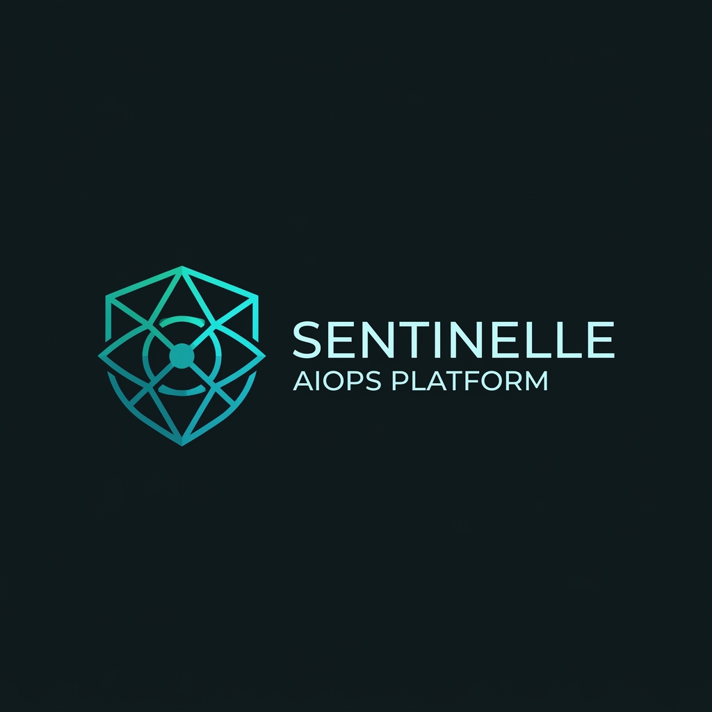
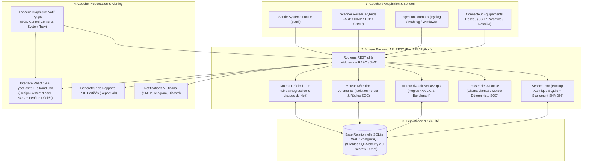

<div align="center">



# Sentinelle AIOps v2.0

**Plateforme Centralisée d'Administration Système & Réseau, Supervision Prédictive, Cybersécurité et NetDevOps**

[-78D8BA?style=for-the-badge)](Documentation/Cahier_des_Charges_Sentinelle_AIOps_v2.pdf)
[](backend/)
[](backend/app/main.py)
[](frontend/)
[](backend/app/modules/)
[](launcher.py)

*« La plateforme Sentinelle AIOps transforme l'administration système et réseau d'une gestion réactive, cloisonnée et manuelle vers un pilotage unifié, prédictif, sécurisé et partiellement automatisé. »*

[Cahier des Charges PDF](Documentation/Cahier_des_Charges_Sentinelle_AIOps_v2.pdf) • [Dossier Technique E6](Documentation/dossier_technique_bts_sio.md) • [Nouveautés v2](Documentation/Fonctionnalité_v2.md)

</div>

---

## Sommaire

1. [Contexte & Problématique](#-1-contexte--problématique)
2. [Proposition de Valeur & Comparatif](#-2-proposition-de-valeur--comparatif)
3. [Objectifs SMART & Compétences BTS SIO SISR](#-3-objectifs-smart--compétences-bts-sio-sisr)
4. [Architecture Technique & Structure du Projet](#-4-architecture-technique--structure-du-projet)
5. [Spécifications des 6 Modules Métier](#-5-spécifications-des-6-modules-métier)
6. [Modèle de Données (Base Relationnelle)](#-6-modèle-de-données-base-relationnelle)
7. [Sécurité Applicative, RBAC & PRA](#-7-sécurité-applicative-rbac--pra)
8. [Design System « Laser SOC » & Expérience Desktop](#-8-design-system--laser-soc--expérience-desktop)
9. [Installation, Exécution & Compilation](#-9-installation-exécution--compilation)
10. [Comptes de Démonstration (Jury E6)](#-10-comptes-de-démonstration-jury-e6)
11. [Tests & Validation Qualité](#-11-tests--validation-qualité)

---

## 1. Contexte & Problématique

Dans les PME et ETI (50 à 500 postes), les équipes d'administration système et réseau font face à **cinq défis structurels majeurs** :

- **Fragmentation des outils** : L'administrateur jongle quotidiennement entre des outils disparates (Zabbix/Nagios pour la supervision, scripts manuels pour le réseau, tableurs Excel pour l'inventaire, analyse manuelle de fichiers `syslog`/`auth.log`). Cette dispersion provoque une perte de temps critique et empêche toute corrélation croisée.
- **Posture purement réactive** : Les pannes (saturation disque, fuite mémoire, surcharge CPU) ne sont traitées qu'après leur survenue, dégradant directement la continuité de service (SLA).
- **Volume ingérable de journaux (Logs)** : Des milliers de lignes de logs sont générées chaque heure sur les serveurs et pare-feu. Sans analyse automatisée par apprentissage statistique, les tentatives d'intrusion lentes (*low-and-slow brute-force*, scans distribués) passent sous le radar.
- **Dérive des configurations réseau (*Configuration Drift*)** : Les modifications manuelles en CLI sur les routeurs et commutateurs introduisent des failles de sécurité non conformes aux standards **CIS Benchmark**, sans sauvegarde intègre ni piste d'audit.
- **Visibilité incomplète du parc et équipements fantômes (*Rogue Devices*)** : L'absence de découverte réseau continue laisse proliférer des machines non déclarées sur les VLANs de production.

---

## 2. Proposition de Valeur & Comparatif

**Sentinelle AIOps** réunit dans une interface unique, 100 % autonome et déployable hors-ligne (*On-Premise*), la supervision prédictive, la détection d'anomalies par Machine Learning, l'audit NetDevOps CIS, la gestion de parc active et un Assistant IA SOC local.

| Critère | Zabbix / Nagios | Wazuh / ELK | Ansible / AWX | NetBox / GLPI | Datadog / Dynatrace | **Sentinelle AIOps v2** |
| :--- | :---: | :---: | :---: | :---: | :---: | :---: |
| **Supervision temps réel** | Oui | Partiel | Non | Non | Oui | **Oui (Sonde locale & SNMP)** |
| **Prédiction TTF (IA)** | Non | Non | Non | Non | Payant (Cloud) | **Oui (`LinearRegression` & Holt)** |
| **Détection d'anomalies Logs (ML)** | Non | Règles statiques | Non | Non | Payant (Cloud) | **Oui (`IsolationForest`)** |
| **Audit réseau CIS & NetDevOps** | Non | Host-only | Playbooks manuels | Non | Non | **Oui (Moteur YAML + Diff + SSH)** |
| **Inventaire & Scan Réseau Réel** | Découverte basique | Agent requis | Non | Saisie / Agent | Agent requis | **Oui (ARP / TCP / HTTP + Rogue)** |
| **Coût & Souveraineté des données** | Gratuit (Complexe) | Gratuit (Lourd : 8 Go+ RAM) | Gratuit (CLI) | Gratuit | Très élevé (SaaS) | **Open-Source, 100 % Local & Léger** |

---

## 3. Objectifs SMART & Compétences BTS SIO SISR

### Objectifs Opérationnels Mesurables (SMART)

| ID | Domaine | Objectif Mesurable | Indicateur & Cible de Validation |
| :---: | :--- | :--- | :--- |
| **O1** | **Cybersécurité** | Détecter automatiquement les anomalies de connexion (brute-force, scan de ports, élévation de privilèges) dans les journaux systèmes. | Taux de détection **≥ 90 %**, faux positifs **< 10 %**, traitement **< 2 s** pour 10 000 lignes. |
| **O2** | **Supervision Prédictive** | Prédire la saturation des ressources serveur (CPU, RAM, Disque) avant l'incident via le calcul du *Time-To-Failure* (TTF). | Écart de prédiction **< 20 %** sur fenêtre glissante, métriques **$R^2$** et **MAPE** affichées en temps réel. |
| **O3** | **NetDevOps** | Auditer automatiquement les configurations réseau selon le référentiel **CIS Benchmark** avec remédiation assistée par IA locale et validation humaine. | Audit complet en **< 30 s** par équipement, score de conformité sur 100 %, génération de commandes CLI exactes. |
| **O4** | **Gestion de Parc** | Centraliser l'inventaire du parc informatique avec découverte active, détection des *Rogue Devices* et calcul d'un score de santé composite. | Scan multi-threadé (`/24`) silencieux, détection automatique de l'OS/constructeur MAC, terminal SSH intégré. |
| **O5** | **Reporting & Alertes** | Fournir un tableau de bord unifié, générer des rapports PDF certifiés et notifier les administrateurs en temps quasi-réel. | Génération PDF en **< 5 s** (empreinte **SHA-256**), notifications multicanal (Email, Telegram, Discord) **< 60 s**. |
| **O6** | **Sécurité & PRA** | Garantir la confidentialité des accès, le contrôle RBAC, la traçabilité des actions et la résilience de la base de données. | Authentification **JWT + MFA**, hachage **bcrypt**, chiffrement **Fernet (AES-128-CBC)**, sauvegarde PRA atomique à chaud. |

### Couverture du Référentiel BTS SIO — Option SISR (Épreuve E6)

- **Bloc 1 — Support et mise à disposition de services informatiques** : Inventaire automatisé du parc, gestion du cycle de vie des équipements, surveillance de la disponibilité, tableaux de bord et rapports d'exploitation PDF.
- **Bloc 2 — Administration des systèmes et des réseaux (SISR)** : Collecte de métriques système et réseau, administration à distance via SSH/Netmiko, sauvegarde et versionnement des configurations de routeurs/commutateurs, maintien en condition opérationnelle (MCO) et plan de reprise d'activité (PRA).
- **Bloc 3 — Cybersécurité des services informatiques** : Analyse automatisée des journaux d'événements par Machine Learning, durcissement des configurations selon les normes CIS, anonymisation RGPD des adresses IP, contrôle d'accès basé sur les rôles (RBAC), protection des secrets et journal d'audit inaltérable.

---

## 4. Architecture Technique & Structure du Projet

### Flux de Données & Architecture Logique



### Arborescence du Dépôt

```text
Sentinelle-AIOPS-v2/
├── backend/                        # API REST FastAPI & Moteurs Métier Python
│   ├── app/
│   │   ├── core/                   # Configuration, sécurité JWT/bcrypt/Fernet, alertes, PDF ReportLab
│   │   ├── db/                     # Session SQLAlchemy (SQLite WAL), initialisation & auto-réparation
│   │   ├── models/                 # 9 modèles ORM SQLAlchemy (utilisateurs, équipements, métriques...)
│   │   ├── modules/                # 6 Modules Métier découplés :
│   │   │   ├── admin/              #   RBAC, Utilisateurs, Journal d'audit, Sauvegardes PRA SHA-256
│   │   │   ├── assistant/          #   Agent IA conversationnel SOC (lecture seule + 1-click deploy)
│   │   │   ├── auth/               #   Authentification JWT, MFA, verrouillage anti-bruteforce
│   │   │   ├── netdevops/          #   Audit CIS YAML, sauvegardes config, diff visuel, push SSH
│   │   │   ├── parc/               #   Inventaire, scan réseau réel silencieux, Rogue Devices, SSH
│   │   │   ├── securite/           #   Ingestion logs, Isolation Forest, anonymisation RGPD
│   │   │   └── supervision/        #   Collecte psutil, prédiction TTF, R², MAPE, lissage de Holt
│   │   ├── schemas/                # Schémas de validation Pydantic v2
│   │   └── main.py                 # Point d'entrée FastAPI, sonde temps réel & serveur SPA intégré
│   ├── rules/
│   │   └── cis_rules.yaml          # Référentiel déclaratif de règles d'audit CIS Benchmark
│   └── tests/                      # Suite de 60 tests unitaires et d'intégration (Pytest)
├── frontend/                       # Application Single-Page React 19 + TypeScript + Vite
│   └── src/
│       ├── api/                    # Client HTTP typé & intercepteurs JWT
│       ├── components/             # Layout SOC, Terminal SSH modal, Moteur d'icônes SVG hors-ligne
│       ├── context/                # Contexte global (Authentification, Thème horaire auto, Live Sync)
│       └── pages/                  # Vues des 7 écrans (Dashboard, Supervision, Sécurité, NetDevOps, Parc, IA, Admin)
├── Documentation/                  # Livrables documentaires BTS SIO E6
│   ├── Cahier_des_Charges_Sentinelle_AIOps_v2.pdf
│   ├── dossier_technique_bts_sio.md
│   ├── Fonctionnalité_v2.md
│   └── sentinelle_logo.png
├── launcher.py                     # Centre de contrôle graphique natif PyQt6 (Zéro Console + System Tray)
├── sentinelle.spec                 # Spécification de compilation PyInstaller (Exécutable autonome)
├── installer.nsi                   # Script NSIS Modern UI 2 pour l'installateur Windows officiel
└── requirements.txt                # Dépendances Python épinglées
```

---

## 5. Spécifications des 6 Modules Métier

### Module 1 — Cybersécurité & Détection d'Anomalies (`securite`)
- **Ingestion Multi-Formats** : Analyse des journaux systèmes Linux (`syslog`, `auth.log`), pare-feu et événements Windows.
- **Machine Learning Non Supervisé (`IsolationForest`)** : Extraction de caractéristiques comportementales (fréquence de requêtes par IP source, taux d'échec d'authentification, entropie des ports ciblés, horaire atypique) pour isoler les attaques sans signature préalable.
- **Anonymisation RGPD à la volée** : Pseudonymisation cryptographique salée (`SHA-256`) des adresses IP et identifiants personnels dans les journaux conformément aux exigences de protection des données.
- **Corrélation Multi-Modules** : Croisement automatique entre une alerte d'intrusion réseau et une dérive de performance CPU/RAM sur l'équipement ciblé.

### Module 2 — Supervision Prédictive & *Time-To-Failure* (`supervision`)
- **Collecte Temps Réel** : Sonde locale `psutil` intégrée (CPU, RAM, Disque, Latence réseau) doublée de profils de simulation réalistes (Normal, Fuite mémoire, Attaque DDoS, Pic de charge, Défaillance disque).
- **Modélisation Mathématique du TTF** : Combinaison de la **Régression Linéaire (`scikit-learn`)** et du **Lissage Exponentiel Double de Holt** pour projeter la trajectoire des ressources et estimer le nombre d'heures ou de jours avant le franchissement du seuil critique (90 %).
- **Indicateurs de Fiabilité Statistique** : Calcul et affichage transparent du coefficient de détermination **$R^2$**, de l'erreur moyenne absolue en pourcentage (**MAPE**) et de l'intervalle de confiance à 95 %.

### Module 3 — NetDevOps & Conformité CIS Benchmark (`netdevops`)
- **Moteur d'Audit Déclaratif YAML** : Évaluation automatisée des configurations d'équipements (Cisco IOS, Linux, pfSense/FortiGate) face aux règles du référentiel [`backend/rules/cis_rules.yaml`](backend/rules/cis_rules.yaml) (désactivation de Telnet, protocole SSHv2 exclusif, chiffrement des mots de passe, ACL, NTP, SNMPv3, bannières légales).
- **Versionnement & Diff Visuel** : Sauvegarde horodatée des configurations avec empreinte d'intégrité **SHA-256** et comparateur visuel côte-à-côte (*Diff Viewer*) mettant en évidence les ajouts et suppressions.
- **Remédiation Assistée par IA & Validation Humaine (*Human-in-the-Loop*)** : Génération des commandes CLI correctives exactes via LLM local (Ollama) ou moteur déterministe SOC, soumises à la validation explicite de l'administrateur avant déploiement SSH (`Netmiko`/`Paramiko`).

### Module 4 — Gestion de Parc Informatique & Scan Réseau Réel (`parc`)
- **Découverte Active Silencieuse** : Scan hybride réel du sous-réseau local (`ARP`, `ICMP Ping`, sondes `TCP` multi-ports `22/80/135/161/443/445/3389`, bannières `HTTP` et résolution `NetBIOS/DNS`) exécuté en arrière-plan sans aucune fenêtre de terminal parasite (`CREATE_NO_WINDOW`).
- **Détection des *Rogue Devices*** : Identification immédiate des équipements physiques détectés sur le LAN mais non référencés dans la base officielle, avec enrôlement en 1 clic.
- **Score de Santé Composite (0–100)** : Calcul pondéré en temps réel combinant la disponibilité, la charge système, les alertes de sécurité actives et le taux de conformité CIS.
- **Terminal SSH Interactif Intégré** : Exécution directe de commandes d'administration et de diagnostic à distance depuis l'interface web avec journalisation d'audit.

### Module 5 — Reporting, Administration, RBAC & PRA (`admin`)
- **Rapports PDF Certifiés** : Génération instantanée via `ReportLab` de rapports d'audit exécutifs incluant KPIs, inventaire, événements critiques et sceau d'intégrité cryptographique **SHA-256**.
- **Alerting Multicanal & Mode Démo E6** : Envoi d'alertes critiques par **Email (SMTP)**, **Telegram Bot** et **Discord Webhook**, avec un mode de simulation intégré garantissant une démonstration fluide devant le jury même sans accès Internet.
- **Plan de Reprise d'Activité (PRA)** : Sauvegarde atomique à chaud de la base SQLite (`sqlite3.Connection.backup`), vérification d'intégrité `PRAGMA integrity_check` et restauration sécurisée.

### Module 6 — Assistant IA Conversationnel SOC (`assistant`)
- **Agent Analytique en Lecture Seule** : Interrogation en langage naturel de l'état de l'infrastructure (ex. *« Quels serveurs risquent une saturation disque d'ici 48h ? »*, *« Génère le correctif CIS pour le routeur cœur »*).
- **Communication Clinique SOC** : Réponses structurées sans emojis superflus, utilisant des balises normalisées (`[CRITIQUE]`, `[MAJEUR]`, `[CONFORME]`, `[ACTION REQUISE]`) et une passerelle d'envoi en 1 clic des correctifs vers le module NetDevOps.

---

## 6. Modèle de Données (Base Relationnelle)

L'architecture de persistance repose sur **SQLAlchemy 2.0** (SQLite en mode `WAL` par défaut pour les performances concurrentes, 100 % compatible PostgreSQL) structurée autour de **9 tables normalisées** :

| Table SQL | Modèle ORM | Rôle & Données Clés |
| :--- | :--- | :--- |
| `utilisateurs` | `Utilisateur` | Comptes opérateurs, hash `bcrypt`, rôle RBAC (`admin`, `technicien`, `visiteur`), compteur d'échecs et verrouillage. |
| `equipements` | `Equipement` | Inventaire du parc (IP, MAC, hostname, OS, type, criticité, score de santé, statut *Rogue*, secrets SSH/SNMP chiffrés `Fernet`). |
| `metriques` | `Metrique` | Séries temporelles des sondes (CPU %, RAM %, Disque %, Latence ms, Uptime). |
| `predictions` | `Prediction` | Résultats des modèles IA (TTF en heures, pente de régression, $R^2$, MAPE, niveau de risque). |
| `evenements_securite` | `EvenementSecurite` | Alertes SIEM/ML (`IsolationForest`), IP source pseudonymisée RGPD, score d'anomalie, sévérité. |
| `audits_reseau` | `AuditReseau` | Rapports d'évaluation CIS Benchmark par équipement, score de conformité, détails JSON des règles échouées. |
| `sauvegardes_config` | `SauvegardeConfig` | Historique versionné des configurations réseau avec empreinte `SHA-256`. |
| `alertes` | `Alerte` | File centralisée des notifications multi-modules avec cycle d'acquittement opérateur. |
| `journal_audit` | `JournalAudit` | Piste d'audit immuable (*Audit Trail*) traçant chaque action sensible (auteur, horodatage UTC, ressource, IP). |

---

## 7. Sécurité Applicative, RBAC & PRA

### Matrice des Droits d'Accès (RBAC)

| Fonctionnalité / Action | Visiteur (`visiteur`) | Technicien N2/N3 (`technicien`) | Administrateur (`admin`) |
| :--- | :---: | :---: | :---: |
| Consultation Dashboard, Supervision, Parc & Rapports | Lecture seule | Oui | Oui |
| Lancement de scans réseau, audits CIS & analyses ML | Non | Oui | Oui |
| Acquittement des alertes & utilisation du Terminal SSH | Non | Oui | Oui |
| Déploiement de correctifs réseau (Push SSH NetDevOps) | Non | Validation requise | Oui |
| Gestion des comptes utilisateurs, rôles & politiques | Non | Non | **Exclusif** |
| Déclenchement de sauvegardes / restaurations PRA | Non | Non | **Exclusif** |

### Mesures de Défense en Profondeur
- **Authentification Robuste** : Jetons **JWT (`HS256`)** à durée de vie limitée, support du second facteur (**MFA**) et hachage des mots de passe via **`bcrypt`**.
- **Protection Anti-Bruteforce** : Verrouillage automatique du compte pendant **15 minutes** après **5 tentatives infructueuses** consécutives, avec journalisation dans le `journal_audit`.
- **Chiffrement des Secrets au Repos** : Les identifiants SSH et communautés SNMP des équipements supervisés sont chiffrés symétriquement en base via **`Fernet` (AES-128-CBC + HMAC-SHA256)**.

---

## 8. Design System « Laser SOC » & Expérience Desktop

L'interface respecte une charte graphique professionnelle haute lisibilité conçue pour les centres d'opérations de sécurité (SOC) :

- **Bascule Horaire Automatique Jour / Nuit** :
  - **Mode Nuit « Laser SOC » (`19h00 – 07h00`)** : Fond carbone profond (`#090C0E` / `#101416`), cartes ardoise (`#14181B`), accents émeraude télémétrique (`#78D8BA`), cyan (`#81D0F8`) et corail critique (`#FFB4AB`).
  - **Mode Jour Haute Clarté (`07h00 – 19h00`)** : Palette claire optimisée pour les environnements lumineux et les vidéo-projecteurs de soutenance, commutable manuellement en 1 clic.
- **100 % Autonome Hors-Ligne** : Moteur d'icônes vectorielles SVG embarqué ([`frontend/src/components/ui/Icon.tsx`](frontend/src/components/ui/Icon.tsx)) ne nécessitant aucune connexion CDN externe.
- **Lanceur Graphique Natif `PyQt6` ([`launcher.py`](launcher.py))** :
  - Démarre le serveur backend de manière totalement invisible (zéro fenêtre `cmd.exe` ou `conhost.exe`).
  - Ouvre automatiquement l'interface dans une fenêtre applicative dédiée sans barre d'adresse.
  - Intègre une icône dans la zone de notification Windows (*System Tray*) permettant de rouvrir la console ou d'arrêter proprement les services.

---

## 9. Installation, Exécution & Compilation

### Option A — Exécution Directe (Exécutable Windows Autonome)

1. Téléchargez ou lancez directement **`dist/Sentinelle-AIOps-Setup.exe`** (Installateur officiel Windows) ou **`dist/Sentinelle-AIOps.exe`** (Version portable autonome).
2. Le **Centre de Contrôle SOC (`PyQt6`)** démarre automatiquement le moteur FastAPI sur le port `8000`, initialise la base de données persistante (`data/sentinelle.db`) et ouvre l'interface applicative.

### Option B — Environnement de Développement (Code Source)

#### Prérequis
- **Python 3.11+** (compatible jusqu'à Python 3.14)
- **Node.js 20+** & `npm`

#### 1. Installation et lancement du Backend (FastAPI)
```powershell
# Créer et activer l'environnement virtuel (optionnel mais recommandé)
python -m venv .venv
.\.venv\Scripts\Activate.ps1

# Installer les dépendances Python
pip install -r requirements.txt

# Lancer le serveur API sur http://127.0.0.1:8000 (Documentation Swagger sur /docs)
uvicorn backend.app.main:app --host 127.0.0.1 --port 8000 --reload
```

#### 2. Installation et lancement du Frontend (React / Vite)
```powershell
cd frontend
npm install

# Mode développement avec Hot-Reload (http://localhost:5173)
npm run dev

# Ou compiler le build de production servi directement par FastAPI
npm run build
```

#### 3. Lancement via le Centre de Contrôle Desktop (`PyQt6`)
```powershell
python launcher.py
```

### Option C — Recompiler l'Exécutable (`.exe`) et l'Installateur (`Setup.exe`)
```powershell
# 1. Compiler le frontend React
cd frontend && npm run build && cd ..

# 2. Générer l'exécutable autonome via PyInstaller
pyinstaller --clean -y sentinelle.spec

# 3. Générer l'installateur Windows via NSIS
makensis installer.nsi
```

---

## 10. Comptes de Démonstration (Jury E6)

Au premier démarrage (ainsi qu'à chaque lancement via le mécanisme d'auto-vérification de [`backend/app/db/init_db.py`](backend/app/db/init_db.py)), trois profils de démonstration correspondant aux trois niveaux d'habilitation **RBAC** sont automatiquement provisionnés et accessibles en **1 clic** depuis l'écran de connexion :

| Rôle RBAC | Identifiant | Mot de passe | Périmètre d'accès |
| :--- | :---: | :---: | :--- |
| **Administrateur Sécurité** | `admin` | `AdminPassword2026!` | Accès total : Supervision, Scans, NetDevOps, Gestion des comptes, PRA & Audit Trail. |
| **Technicien N2 / N3** | `tech` | `TechPassword2026!` | Exploitation opérationnelle : Supervision, Scans réseau, Audits CIS, Terminal SSH. |
| **Visiteur / Auditeur** | `visiteur` | `VisiteurPassword2026!` | Consultation en lecture seule des tableaux de bord, métriques et indicateurs. |

> **Note** : Le formulaire **« Créer un compte »** sur la page d'accueil permet également d'enregistrer à la volée de nouveaux opérateurs persistés dans la base SQLite avec choix du rôle pour tester immédiatement le cloisonnement des permissions.

---

## 11. Tests & Validation Qualité

Le projet intègre une suite complète de **60 tests automatisés** (`pytest`) couvrant l'authentification, le RBAC, le verrouillage anti-bruteforce, la prédiction TTF, la détection d'anomalies ML, l'audit CIS, la découverte de parc, la génération PDF et les sauvegardes PRA :

```powershell
python -m pytest backend/tests -v
```

---

<div align="center">

**Projet réalisé dans le cadre de l'Épreuve E6 du BTS Services Informatiques aux Organisations (Option SISR) — Session 2026**  
Développé par **Edwin Jamel Kouokam** — **HVXS-TEAM**

</div>
